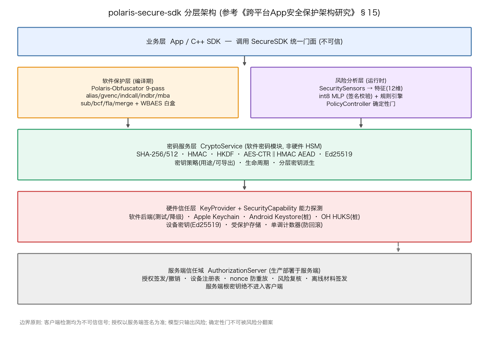
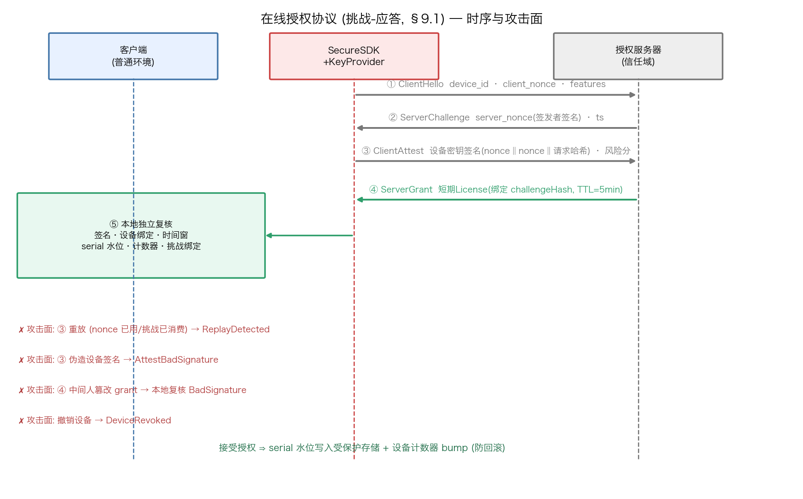
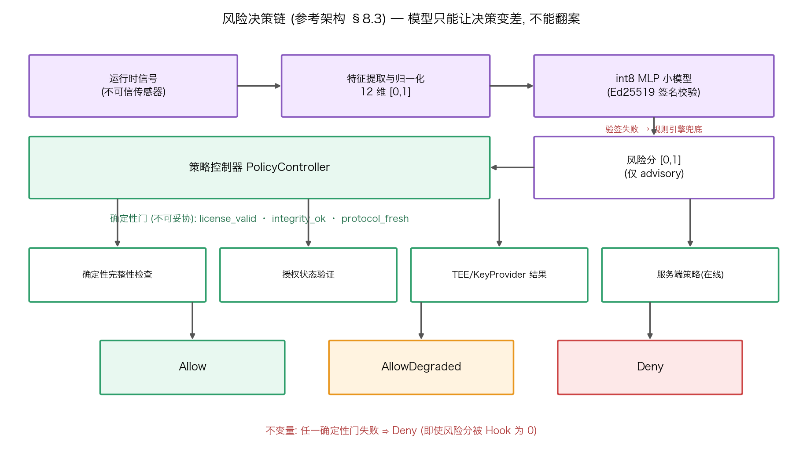
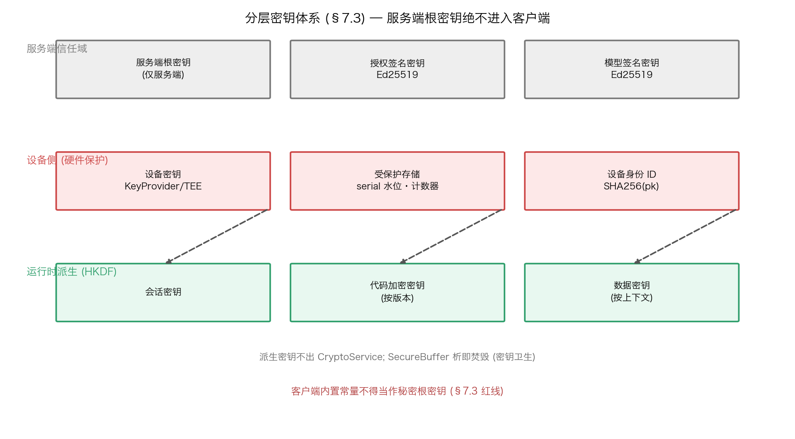

# 01 · 架构设计

> 本目录 (`polaris-secure-sdk/`) 是《跨平台App安全保护架构研究》的**可运行参考实现**。
> 参考文档给出原则与边界, 本设计将六层架构落为代码、测试与量化数据。

## 一、设计目标与威胁模型

沿袭参考架构 §2, 保护目标与攻击者假设不变:

- 攻击者拥有 App 包与二进制, 可静态分析、动态调试、Hook、注入、内存读取、
  Root/越狱、桌面端高权限, 并可使用 AI 辅助分析与自动化脚本。
- **必须承认的边界** (§2.3): 攻击者完全控制的客户端中, 纯软件机制不能保证核心
  逻辑永远无法恢复, 也不能保证客户端上报的检测结果真实。本 SDK 的目标是
  **提高攻击成本、保护密钥与授权边界、消除客户端单点绕过**, 而非承诺绝对防破解。

## 二、六层架构映射



| 层 | 参考架构职责 | 本实现 (代码位置) | 信任级别 |
|---|---|---|---|
| 业务层 | 业务逻辑、调用安全接口 | `SecureSDK` 门面 (`include/polaris_secure/secure_sdk.h`) | 不可信 |
| 软件保护层 | 提高静态/动态逆向成本 | Polaris-Obfuscator 9-pass 编译 (`scripts/obfuscation_matrix.sh`); WBAES 白盒 (`demos/wbaes/`) | 攻击面内 |
| 风险分析层 | 异常模式识别, 输出风险信号 | Sensors + int8 MLP + PolicyController (`src/risk_model.cpp`) | 不可信决策辅助 |
| 密码服务层 | 统一密码 API 与密钥管理 | `CryptoService` (`src/crypto_service.cpp`) + 自包含原语 (`src/crypto/`) | 依部署而定 |
| 硬件信任层 | 设备密钥、受保护状态 | `KeyProvider` 多后端 (`src/key_provider.cpp`) | 相对可信, 依平台 |
| 服务端 | 授权签发、撤销、风险复核 | `AuthorizationServer` 模拟器 (`src/server/`), 生产部署于服务端 | 服务端信任域 |

**与参考架构的对应关系**: 参考文档 §15 的每层职责均映射到具体模块;
§4.1 模块职责表的“信任级别”列由 `CapabilityReport` 如实上报而非硬编码。

## 三、模块清单

```
include/polaris_secure/
  bytes.h           ByteView / SecureBuffer(焚毁) / 恒时比较 / hex
  crypto.h          原语: SHA-256/512, HMAC, HKDF, AES-128, AEAD, Ed25519, CSPRNG
  crypto_service.h  密码服务层 API (§7.2 的落地)
  key_provider.h    硬件信任层抽象 + SecurityCapability 分级
  license.h         授权材料 (211B 定长, Ed25519 签名)
  protocol.h        在线协议消息 (ClientHello/Challenge/Attest/Grant/Deny)
  authorization_server.h  服务端模拟器 (签发/撤销/防重放/风险复核)
  risk_model.h      特征集 / 模型包 / 规则引擎 / PolicyController
  secure_sdk.h      统一门面
src/                实现 (crypto/ server/ 其余一一对应)
tests/              6 套自动化验证 (112+ 断言, 18 项攻击模拟)
tools/              conformance(混淆矩阵载荷) / bench_core(基准) / gen_mlp_model(模型)
scripts/            一键验证 / 混淆矩阵 / 报告生成 / 配图生成
```

## 四、关键数据流

### 4.1 在线授权 (挑战-应答)



1. 客户端发送 `ClientHello`(device_id, client_nonce, 能力等级)。
2. 服务器返回签名 `ServerChallenge`(server_nonce, ts)。
3. 客户端用**设备密钥**(KeyProvider) 对 (双 nonce ‖ 请求哈希) 签名, 上报风险分。
4. 服务器: 注册表/撤销/nonce 防重放/挑战时效/签名/风险策略 全部通过后,
   签发**短期 License**(TTL 5min, 绑定 `challengeHash(client_nonce‖server_nonce)`)。
5. 客户端**本地独立复核**(签名/设备/时间窗/serial 水位/计数器/挑战绑定),
   通过才接受; 接受时推进受保护水位并 bump 计数器。

任何一步失败都有独立错误码 (见 `tests/test_protocol_online.cpp` 的 8 项攻击模拟)。

### 4.2 风险决策链



信号(不可信) → 12 维特征 → **签名校验的** int8 MLP → 风险分(advisory) →
策略控制器: 确定性门(license/integrity/replay) **一票否决**, 风险分只影响
降级/拒绝。模型验签失败 → 规则引擎兜底, 确定性策略不受影响。

### 4.3 分层密钥



服务端根密钥/签发密钥/模型密钥仅在服务端; 设备密钥在 KeyProvider;
会话/数据/代码加密密钥由 HKDF 按上下文派生, 不落盘 (`docs/02`)。

## 五、设计原则 (对应参考架构 §14 的 8 条决策)

| # | 参考架构决策 | 本实现的体现 |
|---|---|---|
| 1 | 不全量 TEE 化 | KeyProvider 只放设备密钥/计数器/受保护存储, 无业务逻辑 |
| 2 | 不把软件隔离称为硬件可信 | CapabilityReport 如实分级; Software 后端明示"无硬件保证" |
| 3 | 软件密码模块 ≠ 硬件 HSM | crypto_service.h 顶部注释声明; 密钥保护程度跟随 Provider |
| 4 | 模型不决定授权 | `policyDecide`: 门失败 ⇒ Deny, 与风险分无关 (有攻击模拟测试) |
| 5 | 客户端检测结果非可信证明 | 服务器复核 + 本地复核双向独立; 风险分仅策略输入 |
| 6 | 不承诺绝对防破解 | docs/07 §五"已知局限"四项如实声明 |
| 7 | 统一接口, 按平台分级 | SecurityCapability 五级 + 各平台后端矩阵 (docs/03) |
| 8 | 以实测收益定保护强度 | 混淆矩阵量化等价性/体积/耗时, 支撑分级决策 (docs/07 §四) |

## 六、保护分级落地 (§6.3)

| 等级 | 对象 | 本仓库手段 |
|---|---|---|
| L1 普通 | UI/日志/一般逻辑 | 常规编译 + 符号隐藏 |
| L2 重要 | 关键判断、部分算法 | Polaris 局部 pass (mba/sub/bcf) + 完整性检查 |
| L3 核心 | 授权验证、密钥操作 | 全 9-pass + AEAD/签名 + 服务端复核; 白盒表 (WBAES) 按需 |

混淆矩阵数据 (docs/07 §四) 显示: 控制流型操作 (Ed25519/license verify) 全 pass
开销 ~1.1×, 数据热点 (AES/SHA 循环) ~5×。**分级保护由此有量化依据**: L3 用全集,
热点数据路径保持轻量。

## 七、目录之外的配套资产

- **Polaris-Obfuscator** (`../src/`): IR+MIR 双层混淆编译器, 软件保护层引擎。
- **WBAES** (`../demos/wbaes/`): 白盒 AES 导出 (已真机验证), L3 密钥绑定场景。
- **参考架构原文**: `docs/` 各处引用的 §编号均指《跨平台App安全保护架构研究》。
